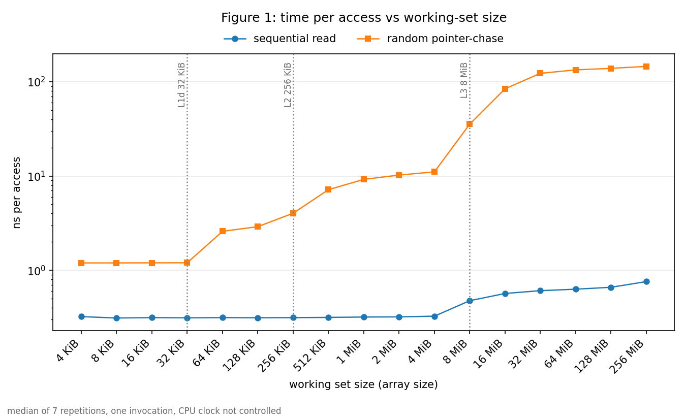
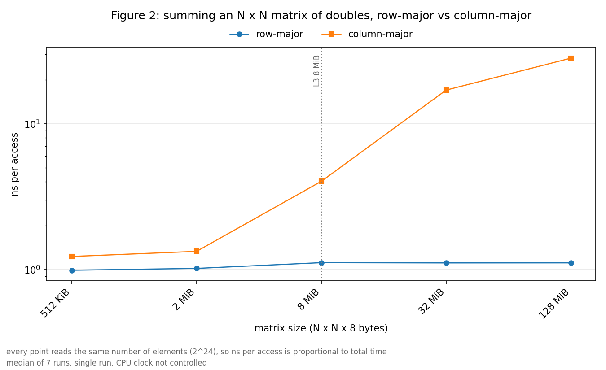
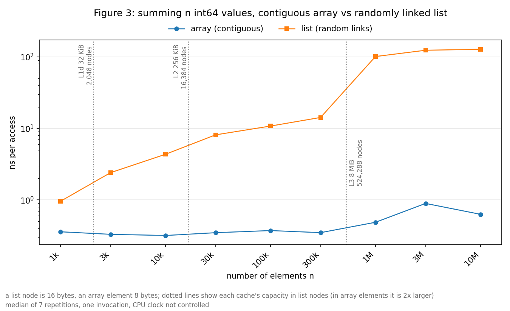

# cpu-cache-lab

Small C++ micro-benchmarks that make CPU cache effects visible (time per memory access versus working-set size, matrix traversal order, array versus linked list), a `perf stat` profile that shows the hardware counters behind one of them, plots of the results, and a small Python LLM agent that analyzes the output under human approval. Everything was measured on one machine (Intel Core i7-8565U, see `results/cpu_info.txt` below), so the numbers describe that machine only.

**About the numbers in this README:** they come from one run on the author's machine. They are read from the local `results/` files, which are gitignored (not in the repository), from the profiler output in `results/profile_*.csv`, and from `agent/FINDINGS.md`. The file next to each number says where it came from. A re-run gives different numbers (single runs, uncontrolled CPU clock); the shape of the results is what to compare. Derived values (ratios, per-element counts) are my arithmetic on those numbers and are marked "derived".

## Machine

From `results/cpu_info.txt` (written by `make cpuinfo`, which is the output of `lscpu`):

- Model: Intel(R) Core(TM) i7-8565U CPU @ 1.80GHz
- L1d: 32K per cache (128K total), L2: 256K per cache (1M total), L3: 8M

## How to run

Needs Linux (developed on Ubuntu), `g++` with C++17, `make`, `lscpu`, Python 3.8+. For the profile: `perf` and `taskset`. For the agent: an Anthropic API key with credit.

```bash
python3 -m venv .venv
.venv/bin/pip install -r requirements.txt

make run                      # cpuinfo + the three benchmarks -> results/*.csv, results/cpu_info.txt
.venv/bin/python plot.py      # figures/*.png  (run AFTER make run; results/ is not in git)
make profile                  # perf stat profile -> results/profile_*.csv
```

- `make run` takes about 5 minutes on this machine (measured once on a clean clone). Do not run it with `make -j`: timing runs must not overlap. Close other heavy programs while it runs.
- Individual targets: `make run-sweep`, `make run-matrix`, `make run-list`, `make cpuinfo`.
- `make profile` runs `profile.sh`, pinned to CPU 2 with `taskset`. It uses `perf` from PATH and falls back to the newest `/usr/lib/linux-tools/*/perf` (on Ubuntu `/usr/bin/perf` is only a wrapper that fails when `perf` for the running kernel is not installed). Override with `PERF=/path/to/perf make profile`. If perf prints `<not supported>` for the second event group it is skipped with a message.
- Benchmarks are built with `g++ -O2 -std=c++17` (release only) and use only the C++ standard library.

Analysis agent (makes billed API calls; every tool call needs you to type `y`):

```bash
export ANTHROPIC_API_KEY=...           # the only place the key is read from; never printed or logged
.venv/bin/python agent/agent.py "Which of my results show the largest cache effect, and why?"
# AGENT_MODEL=<model id> to change the model; --max-steps and --max-tokens set the limits
.venv/bin/python agent/test_tools.py   # offline checks of the agent, no API calls
```

## The three benchmarks

All benchmarks warm up once, run 7 repetitions, report the median with `std::chrono::steady_clock`, keep the compiler from deleting the measured loops (volatile sink plus an empty `asm volatile` memory barrier between passes) and print CPU info at start. CSV header: `benchmark,pattern,size_bytes,ns_per_access`.

### 1a. `working_set_sweep`: time per access versus working-set size

Reads an int64 array from 4 KiB to 256 MiB, either **sequentially** or by a **random pointer-chase** (a random single-cycle permutation, so every load depends on the previous one). Source: `results/working_set_sweep.csv`.

| Size | Sequential (ns/access) | Random (ns/access) |
|---|---|---|
| 4 KiB | 0.322 | 1.196 |
| 32 KiB | 0.313 | 1.201 |
| 64 KiB | 0.314 | 2.589 |
| 256 KiB | 0.314 | 4.031 |
| 512 KiB | 0.316 | 7.167 |
| 4 MiB | 0.326 | 11.1 |
| 8 MiB | 0.475 | 35.5 |
| 16 MiB | 0.567 | 84.3 |
| 256 MiB | 0.758 | 145.6 |

Random access is flat up to 32 KiB and then steps up, consistent with the L1d (32K), L2 (256K) and L3 (8M) sizes in `cpu_info.txt`; the cause was not isolated. Sequential access barely moves (0.311 to 0.758 ns).

### 1b. `matrix_traversal`: row-major versus column-major

Sums an N x N matrix of doubles in both orders, N = 256 to 4096, with the same number of element reads (2^24) per point. Source: `results/matrix_traversal.csv`.

| N | Matrix size | Row-major (ns/access) | Column-major (ns/access) | Column / row (derived) |
|---|---|---|---|---|
| 256 | 512 KiB | 0.990 | 1.230 | 1.2 |
| 512 | 2 MiB | 1.018 | 1.333 | 1.3 |
| 1024 | 8 MiB | 1.115 | 4.031 | 3.6 |
| 2048 | 32 MiB | 1.111 | 17.02 | 15.3 |
| 4096 | 128 MiB | 1.112 | 28.20 | 25.4 |

Row-major stays near 1 ns. Column-major reads with a stride of N x 8 bytes (32 KiB at N=4096) and slows down as the matrix reaches and passes the L3 size.

### 1c. `array_vs_list`: contiguous array versus randomly linked list

Sums n int64 values from a contiguous `std::vector<int64_t>` and from a pool of 16-byte nodes linked into one random cycle. The nodes sit in one contiguous vector and only the links are shuffled, so this is **not** a `std::list`. Both patterns compare the same element count n; the byte footprints differ (8 versus 16 bytes per element). Source: `results/array_vs_list.csv`.

| n | Array (ns/element) | List (ns/element) | List / array (derived) |
|---|---|---|---|
| 1,000 | 0.358 | 0.957 | 2.7 |
| 3,000 | 0.330 | 2.405 | 7.3 |
| 10,000 | 0.318 | 4.346 | 13.7 |
| 30,000 | 0.348 | 8.128 | 23.4 |
| 100,000 | 0.373 | 10.8 | 28.9 |
| 300,000 | 0.349 | 14.2 | 40.8 |
| 1,000,000 | 0.487 | 101.3 | 208.1 |
| 3,000,000 | 0.893 | 123.9 | 138.7 |
| 10,000,000 | 0.629 | 127.9 | 203.3 |

The array stays between 0.318 and 0.893 ns. The list rises steeply and reaches 127.9 ns at 10,000,000 elements (160,000,000 bytes). The list is already 2.7 times slower at n = 1,000, where both fit in L1, so the gap is not only about cache lines (see Limitations).

## Figures

Made by `plot.py` from the CSVs above (log-log axes, one marker per measurement, dotted lines at the cache sizes from `cpu_info.txt`). The PNGs in `figures/` are from the author's run; running `make run` and `plot.py` regenerates them from your numbers.

- `figures/fig1_working_set_sweep.png`: ns per access versus working-set size, sequential versus random.
- `figures/fig2_matrix_traversal.png`: row-major versus column-major (x labels include N).
- `figures/fig3_array_vs_list.png`: array versus list against element count; the dotted lines show each cache's capacity in list nodes (cache size / 16 bytes).





## Perf profile of the matrix traversal

`profile.sh` runs `perf stat` (3 repetitions, mean reported, pinned to CPU 2) on `profile_matrix` at N = 4096 for 8 passes: `none` (build and fill the matrix only), `row` and `col`. Every event was counted 100.00% of the time in both event groups (the percentage column of the profile CSVs), so there was no counter multiplexing. The `none` run is the setup baseline (allocation, page faults, the 128 MiB fill), which every run includes; kernel counts are the run minus `none`.

Raw counts (measured by perf), sources `results/profile_none.csv`, `profile_row.csv`, `profile_col.csv` and the `*_group2.csv` files:

| Event | none | row | col |
|---|---|---|---|
| cycles | 254,165,185 | 859,640,974 | 3,730,855,737 |
| instructions | 513,556,158 | 1,050,040,857 | 1,056,725,901 |
| cache-references | 7,814,576 | 41,311,299 | 424,055,250 |
| cache-misses | 6,125,024 | 28,483,457 | 246,296,611 |
| branch-misses | 47,925 | 81,335 | 118,539 |
| L1-dcache-load-misses | 4,761,070 | 21,642,060 | 274,225,886 |
| dTLB-load-misses | 3,903 | 266,624 | 134,194,572 |
| LLC-load-misses | 32,340 | 417,281 | 119,840,995 |

Derived (my arithmetic on the counts above; element reads = 8 x 4096 x 4096 = 134,217,728):

| | row | col |
|---|---|---|
| net cycles (run − none) | 605,475,789 | 3,476,690,552 |
| net instructions | 536,484,699 | 543,169,743 |
| net cache-misses | 22,358,433 | 240,171,587 |
| net cache-references | 33,496,723 | 416,240,674 |
| cycles per element read | 4.51 | 25.90 |
| instructions per cycle (net) | 0.886 | 0.156 |
| cache-misses per element read | 0.167 | 1.789 |
| cache-misses / cache-references (net) | 0.667 | 0.577 |
| L1-dcache-load-misses per element (net) | 0.126 | 2.008 |
| dTLB-load-misses per element (net) | 0.002 | 1.000 |
| LLC-load-misses per element (net) | 0.003 | 0.893 |

perf's own "insn per cycle" column in the CSVs (1.22 for row, 0.28 for col) includes the setup phase, so it differs from the net value above.

Column-major used about 5.7 times the cycles of row-major (derived: 3,476,690,552 / 605,475,789) for about the same number of instructions, and missed the dTLB about once per element.

**The clock moved between runs.** Dividing the cycle count by the run time perf printed in the same line gives 4.090 GHz for `none`, 4.090 GHz for `row` and 0.709 GHz for `col` (derived from `profile_*.csv`). So cycles and nanoseconds are not proportional between the two patterns, and the nanosecond ratio in 1b (25.4) is larger than the cycle ratio (5.7).

## The analysis agent

`agent/agent.py` is a tool-calling loop (anthropic SDK) around a Claude model (`AGENT_MODEL`, default `claude-haiku-5-5`). It can call `list_results`, `read_csv` (CSV files in `results/` and exactly `results/cpu_info.txt`), `run_benchmark` and `run_profile`.

- **Human approval:** before ANY tool runs, the tool name, arguments and effect are printed and you must type `y`; anything else returns "denied by user" to the model.
- **Logging:** every API call (tokens, estimated cost), tool call (arguments, decision, full output) and error is appended to `logs/agent_log.jsonl` (gitignored). The API key is never printed or logged.
- **Safety:** `read_csv` rejects paths, `..`, absolute paths and any name other than `*.csv` and `cpu_info.txt`, and checks the resolved path stays inside `results/`. `run_benchmark` can only start the three fixed `make` targets. Tool output is truncated before it is sent to the model, with a note.
- **Grounding:** the system prompt allows hardware and performance facts only from CSV output, profiler output or `cpu_info.txt`, requires quoting the exact numbers with the file they came from, and requires "not measured" for anything else. This is a prompt rule, not enforcement.
- **Limits and errors:** a step limit and a total-token budget; API errors (billing, rate limit, network, key) end the run with a clear message.

Results of the two real runs (from `agent/FINDINGS.md`; the cost is an estimate from the price constant in `agent.py`, which is unverified):

- **Run 1**, "Which of my results show the largest cache effect, and why?": 4 API calls, 7 tool calls (`list_results` + 6 `read_csv`), all approved, no errors; 11,096 input tokens, 2,995 output tokens, 14,091 total; estimated cost $0.002607. All ratios and baseline-subtracted counts matched the CSVs when recomputed. Three weak spots:
  1. It mixed net and gross numbers: cache-misses and cycles were baseline-subtracted, but IPC (row 1.22, column 0.28) was the raw value including setup.
  2. It misframed `array_vs_list` as "sizes not matched"; the benchmark compares the same element count n, only the byte footprints differ (8 versus 16 bytes per element).
  3. The explanation was thin: it mentioned prefetching only, not dependent loads or the clock caveat.
- **Run 2**, grounding trap, "What is my L2 cache size, and how do you know?": the agent said it was not measured, stated no size from memory, and presented the latency steps in `working_set_sweep.csv` as a hypothesis. Result: pass. Limit: one trap on one model is not proof that it never overclaims.
- **Comparison:** Claude Code answering the Run 1 question directly cited cache sizes "from sysfs", which is outside the CSV/profiler data.
- **Fix added after these runs:** hardware facts were not in `results/`, so the agent could not cite them (Run 2 said "not measured" because the file did not exist yet). `make cpuinfo` now writes `results/cpu_info.txt` (called first by `make run`), the agent may read exactly that file, and the prompt treats it as a valid source. The fix was re-run in Runs 3 and 4 (`agent/FINDINGS.md`):
  - **Run 3**, the same L2 question with the file available: 2 API calls, 1 tool call (`read_csv` `cpu_info.txt`); 3,371 input + 397 output = 3,768 tokens, estimated cost $0.00054. It quoted L2 ONE-SIZE 256K and ALL-SIZE 1M, matching the file.
  - **Run 4**, "How much L1 data cache does my CPU have in total, and does the sweep data show it?": 3 API calls, 3 tool calls (`list_results`, `read_csv` `cpu_info.txt`, `read_csv` `working_set_sweep.csv`); 6,550 input + 1,119 output = 7,669 tokens, estimated cost $0.00121. It quoted L1d ONE-SIZE 32K and ALL-SIZE 128K, tied the random-latency step between 32 KB (1.201 ns) and 64 KB (2.589 ns) to the 32K size, and said a single sweep cannot show the 128K total.
  - **Two weak spots in Run 4:** (a) "256 KiB per core" is not in the file (`lscpu` says per instance) and the agent itself said the file gives no core count; (b) "a single-threaded sweep can only use one L1d" is reasoning from outside the data, stated as fact.

## Measurement pitfalls checked

- **Optimization:** release builds only (`-O2`); loops are protected from deletion by a volatile sink and an `asm volatile` memory barrier between passes (so repeated identical passes cannot be folded into one).
- **Warm-up and repetitions:** one untimed warm-up, 7 timed repetitions, median.
- **Equal work per point:** a fixed number of accesses per point, divided by the accesses actually done.
- **Sizes versus cache sizes:** sizes bracket the L1d, L2 and L3 sizes from `cpu_info.txt`; the arrays are filled before timing so page faults are not measured.
- **Access pattern:** the random pattern is a single cycle (Sattolo), so the chase visits the whole array; sequential access benefits from prefetching and is not a latency measurement.
- **Integer sums** in `array_vs_list`, so floating-point add latency is not a confound.
- **Profile:** setup subtracted (`none` run), pinned to CPU 2, multiplexing percentages checked (all 100.00).

## Limitations and caveats

- **CPU clock not controlled.** The core clock differed between runs inside the profile (0.709 GHz for `col` versus 4.090 GHz for `row`, derived above). The nanosecond results therefore mix stalls with clock changes. The power governor was not changed.
- **Single-run plots hide variance.** Each point is one median of 7 repetitions from one invocation, with no error bars. A second full run on a clean clone gave different numbers at the larger sizes (its CSVs were not kept); small-size values were close.
- **The array outlier at n = 3,000,000.** The array reads 0.893 ns there, above 0.487 at n = 1,000,000 and 0.629 at n = 10,000,000 (`array_vs_list.csv`). It did not reappear in the second run. Not investigated; I treat it as noise.
- **List versus array mixes two effects:** cache-line use and dependent versus independent loads. They were not separated.
- **What perf's `cache-misses` counts** was not verified against Intel documentation in this repository. Row-major's net `cache-misses` (22,358,433) is much larger than its net `LLC-load-misses` (384,941); my guess is that prefetch traffic is included in the first, which I did not test.
- **Power-of-two sizes and strides** can cause cache-set conflicts and TLB misses; the column-major cost mixes line waste, conflicts and TLB misses (the profile shows about one dTLB miss per element).
- **Only one trap question** (Run 2) and two follow-up checks (Runs 3 and 4), all on one model.
- **The cost figures are an estimate** based on a price constant in `agent.py` that I have not verified against the pricing page.
- **Extra files in `results/`:** `results/` can contain extra files from earlier runs; the agent can read any `*.csv` there and is told to name the file for each number. `run_benchmark` overwrites the matching CSV.
- One machine only; no other CPU was tested.

## What I would do next

- Repeat the measurements with `scaling_governor=performance` to see how much of the column-major slowdown is the clock: **not run**.
- Repeat each benchmark several times and plot error bars (min/median/max): **not run**.
- Add more grounding trap questions (other hardware facts, leading questions, questions the data cannot answer): **not run**.
- Separate the dependent-load effect from the cache-line effect in `array_vs_list` (for example a list in sequential link order): **not run**.

## Repository layout

- `bench/`: `working_set_sweep.cpp`, `matrix_traversal.cpp`, `array_vs_list.cpp`, `profile_matrix.cpp`
- `Makefile`, `profile.sh`: build, run, profile
- `plot.py`, `figures/`: plots
- `agent/`: `agent.py`, `test_tools.py`, `FINDINGS.md`
- `results/` (gitignored): CSVs, `cpu_info.txt`, `profile_*.csv`; `logs/` (gitignored): agent log
- `SPEC.md`: the original specification; `CLAUDE.md`: working rules for the coding assistant
